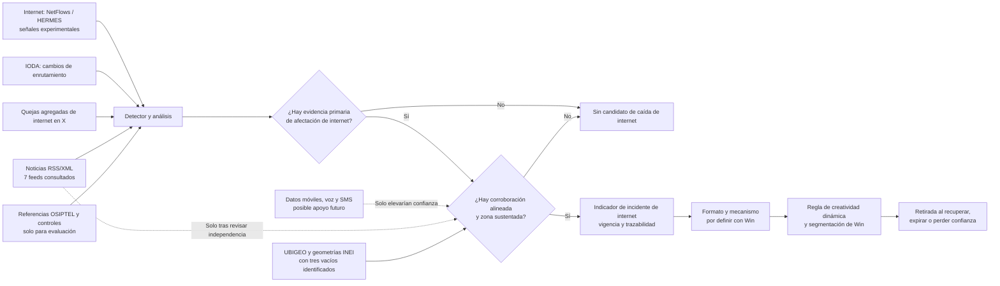

# Propuesta ejecutiva: detección de interrupciones de internet para activar creatividades de Win

**Dirigida a:** Win  
**Fecha:** 25 de octubre de 2026  
**Estado:** el detector local v4 ya se probó mediante replay retrospectivo con Cloudflare Radar NetFlows/anotaciones, IODA, X/TwexAPI y M-Lab HERMES sobre datos archivados. El colector RSS/XML de noticias está conectado como entrada separada de corroboración. En tres capturas del 25 de octubre de 2026, dos completaron 7/7 feeds y analizaron 533 ítems; una tuvo 6/7 feeds válidos y 433 ítems porque El Comercio devolvió HTTP 404. El siguiente intento volvió a obtener 7/7. Ninguna captura produjo candidatos. Tres medios del top 10 no tienen una ruta RSS validada en las direcciones probadas. La regla estricta del replay marcó 8/15 pares positivos y 2/17 controles emparejados, que no son ventanas normales independientes. La integración RSS no cambia esos resultados: no hay noticias históricas alineadas a esos pares, por lo que su aporte incremental aún no está medido. No se recomienda activar campañas todavía.

## 1. Resumen ejecutivo

Win puede convertir las interrupciones de internet de otros operadores en una oportunidad para presentar una alternativa relevante a personas ubicadas en las zonas afectadas. La propuesta es construir un **detector propio de incidentes de internet** que reúna señales de red, determine operador, tecnología y zona cuando exista evidencia suficiente, y entregue un indicador vigente a la plataforma de activación de Win.

**Alcance central:** el incidente que se busca detectar es una interrupción o degradación de internet. Señales coincidentes de datos móviles, voz o SMS podrían aumentar la confianza en un incidente del operador, pero no deben iniciar por sí solas una detección de caída de internet. Una señal de internet móvil solo describe ese servicio móvil y no prueba una falla de internet fijo. Los mapas de cobertura declarada son contexto estático y no evidencia de una interrupción actual.

Esta es la regla objetivo; no significa que esas señales auxiliares ya estén integradas. El PoC actual no recibe alertas de caída de voz/SMS ni eventos móviles en tiempo real. La información móvil revisada de OSIPTEL es periódica y no sirve como confirmación de una interrupción en curso.

Se aplicó el replay v4 a 15 pares positivos operador-incidente y 17 controles emparejados de 8 casos. NetFlows básico marcó 9/15 positivos y 9/17 controles; la regla de candidato estricto del detector (NetFlows persistente o señal IODA, X o HERMES) marcó 8/15 y 2/17. Exigir dos familias independientes marcó 2/15 positivos y 1/17 controles. Estos conteos son descriptivos de la muestra: los controles son operadores no nombrados como afectados durante incidentes reales, no ventanas normales independientes. Por ello no equivalen a tasas operativas de falsos positivos, precisión o desempeño general.

**Recomendación:** usar el detector v4 existente como base de evaluación, separando su replay histórico de cualquier ingesta en vivo. NetFlows es la señal técnica experimental; IODA, X y HERMES ya están incluidos en el replay, con las limitaciones de cada uno. X encontró quejas aisladas, pero ningún cluster de dos autores por distrito y 15 minutos; por esa regla no agregó pares frente a NetFlows. `approved_sources.json` permanece vacío: tener código y resultados reproducibles no convierte a las fuentes en servicios aprobados para operación.

El colector RSS/XML consulta los feeds configurados del top 10 y analiza título, descripción, fecha y nombres de operador/zona. En tres capturas, dos obtuvieron 7/7 feeds válidos y una tuvo 6/7 porque El Comercio devolvió HTTP 404; la siguiente consulta volvió a obtener XML válido. Las tres produjeron cero candidatos. Dos rutas alternativas de El Comercio respondieron con HTML no parseable como RSS/XML. En las capturas completas, RPP, El Comercio, La República, América Noticias e Infobae tenían publicaciones recientes, mientras que Perú21 y ATV mostraban contenido atrasado. Una búsqueda histórica encontró que Infobae reportó una caída de internet fijo de Win en Lima el 15 de abril de 2026. La nota se basó principalmente en reportes de usuarios y redes sociales, por lo que debe tratarse como dependiente de esa familia y no como confirmación independiente. No se comprobó que el RSS hubiera entregado la nota durante el incidente.

En un cotejo prospectivo del 25 de octubre, IODA devolvió un evento BGP candidato de 15 minutos para Claro, pero la respuesta marcó `overlaps_window=false` pese a que su hora calculada cae dentro de la consulta. En esa misma hora, NetFlows mostró valores superiores a la semana previa para los cuatro operadores y Radar no presentó anotaciones coincidentes. La consulta de X quedó inconclusa por una inconsistencia de paginación. Este caso refuerza que una anomalía de enrutamiento aislada no debe activar una creatividad; no aportó distrito ni corroboración de una caída de acceso.

## 2. Problema y oportunidad

Cuando la conexión de un operador se interrumpe o degrada, sus usuarios pueden buscar otra alternativa. Win vende internet y puede adaptar su comunicación por zona para presentar sus servicios en el momento y lugar pertinentes.

Hoy, una campaña no debería depender de una suposición basada en una publicación aislada, un mapa de cobertura o una anomalía general de red. Se necesita distinguir los incidentes reales de internet, identificar qué operador y tecnología están afectados, sostener una zona con evidencia y retirar la activación cuando el incidente deje de estar respaldado.

La oportunidad comercial es contextualizar la creatividad y la segmentación geográfica. **El incremento de conversiones, alcance o ventas no se ha medido** en esta validación y debe tratarse como beneficio potencial, no como resultado demostrado.

## 3. Solución propuesta

Construir un algoritmo propio que convierta señales externas en un estado de **interrupción o degradación de internet** útil para Win. La evidencia primaria debe referirse a conectividad o rendimiento de internet. Las señales de voz, SMS, datos móviles y otros servicios son corroboración auxiliar: podrían elevar la confianza si coinciden por operador, zona y tiempo, pero no crean por sí solas un incidente de internet. Los mapas de cobertura declarada solo aportan contexto estático; no son señales de interrupción.

### Lo que ya está conectado al detector local

La versión v4 implementada (`src/win_validation/detector.py`) combina datos archivados para un replay retrospectivo. Las fuentes que el código usa son:

| Servicio/familia usada en el replay | Función actual dentro del detector | Estado |
|---|---|---|
| Cloudflare Radar NetFlows y anotaciones | Calcula la variación de tráfico por ASN; ambos productos cuentan como una sola familia Cloudflare. | NetFlows: señal directa experimental. Anotaciones: contraste histórico; 0/15 coincidencias. |
| IODA | Busca inicios de eventos de red por ASN dentro de la ventana histórica. | Candidato débil: 1/15 inicios coincidentes. |
| X mediante TwexAPI | Usa conteos históricos agregados de autores con quejas y grupos por distrito/ventana de 15 minutos. | Corroboración social experimental; la regla geográfica no produjo clusters en el replay. |
| M-Lab HERMES | Aplica un filtro exploratorio de caída de rendimiento con coincidencia exacta de operador, área y fecha. | Experimental y de frecuencia diaria; no permite activar por sí solo. |
| RSS/XML: RPP, El Comercio, La República, América Noticias, Infobae, Perú21 y ATV | Colector manual conectado al comando del detector; lee título, descripción y fecha incluidos en cada feed y crea candidatos revisables si aparecen internet, interrupción, operador y zona UBIGEO. No abre las páginas de artículos. | La última consulta tuvo 7/7 feeds XML válidos; 0 candidatos. En una captura intermedia El Comercio devolvió 404 y luego se recuperó; tres medios carecen de una ruta validada. No integra todavía los candidatos actuales en métricas de replay; para entrar como corroboración histórica requiere alineación revisada por operador, zona, hora e independencia. |

**Voz, SMS y disponibilidad de internet móvil:** no son entradas del detector actual. Se considerarían solo como corroboración futura si se encuentra una fuente reciente, atribuible al operador y alineable por zona y hora. No reemplazarían la señal primaria de internet.

El replay lee capturas y resultados históricos guardados; `--fetch-controls` permite volver a consultar controles históricos de NetFlows. `python -m win_validation.detector --fetch-news` consulta los siete feeds RSS/XML configurados, analiza solo metadatos y texto incluido en el feed, y guarda el estado de los feeds y candidatos para revisión. No abre páginas de artículos ni hay una ingesta programada continua. El colector RSS está conectado, pero una noticia solo podrá incorporarse al replay como familia independiente después de revisar manualmente su alineación temporal, geográfica y por operador, y descartar dependencia de quejas sociales. OSIPTEL aporta referencias de incidentes para evaluar; UBIGEO/INEI aporta geografía auxiliar, no señales de caída.

### Lógica que ejecuta hoy el replay

1. Empareja cada señal con operador, incidente y ventana temporal de los archivos de evaluación. En el replay, las familias auxiliares pueden generar candidatos de evaluación; esos resultados no equivalen a una alerta operativa ni a una activación.
2. Marca NetFlows persistente si la diferencia normalizada es menor que −0,02, al menos 90% de los intervalos queda por debajo del comparador y existen al menos ocho pares de intervalos. Es un umbral exploratorio, no calibrado para operación.
3. Marca candidatos de IODA por inicio de evento; X requiere al menos dos autores distintos en un distrito inequívoco durante 15 minutos; HERMES exige operador/área/fecha exactos, caída de throughput ≥40%, fracción anómala ≥80% y al menos cinco clientes.
4. En el replay compara reglas exploratorias: candidato si hay NetFlows persistente o una señal auxiliar, y corroboración si coinciden al menos dos familias. Esta regla retrospectiva sirve para analizar casos; no define activación.
5. En el flujo previsto, primero debe existir evidencia directa y vigente de afectación de internet. Las señales móviles, de voz o SMS solo pueden corroborar ese incidente, nunca reemplazar la evidencia de internet. El simulador local suprime la salida si la señal directa está vencida, la corroboración no coincide o la geografía no está validada.

### Solución objetivo

1. Detectar primero interrupciones o degradaciones de internet en Perú con señales que midan o describan ese servicio.
2. Vincular cada observación con un operador solo cuando la atribución esté sustentada.
3. Registrar la tecnología del incidente principal como fija o móvil solo cuando la fuente la identifique. Una falla de datos móviles no se extrapola a internet fijo. Voz y SMS se registran aparte como señales auxiliares, nunca como el incidente principal de internet. La cobertura declarada se mantiene como contexto geográfico estático.
4. Comparar NetFlows por operador y tiempo con una línea base comprobada, separando observaciones sin atribución suficiente.
5. Emitir un candidato de internet solo cuando exista evidencia directa y vigente de ese servicio y la regla se valide con incidentes y períodos normales independientes. Otras señales coincidentes —por ejemplo, fallas de datos móviles, voz o SMS— pueden elevar la confianza, siempre etiquetadas como corroboración auxiliar. X puede evaluarse como corroboración agregada de quejas de internet por operador, zona y ventana temporal. Los medios del top 10 pueden aportar contexto editorial si una nota identifica servicio, operador, zona y momento; cuando una nota reproduce quejas sociales, ambas señales pertenecen a la misma familia y no cuentan como dos confirmaciones. Ni X ni prensa confirman por sí solos una caída, y no se dirige una creatividad a quien publicó.
6. Publicar un indicador con vigencia limitada y trazabilidad, en el formato y por el mecanismo que Win defina.

La investigación asoció ASN candidatos con Movistar (AS6147), Claro (AS12252), Entel (AS21575) y Bitel (AS262210). Esa correspondencia permite analizar señales de enrutamiento por operador, pero **no demuestra que cada ASN represente toda la red minorista o todas las tecnologías del operador**. El detector debe conservar esa limitación hasta completar el inventario de red.

## 4. Investigación realizada

Se realizó una evaluación local, de solo lectura y con evidencias archivadas. La revisión cubrió:

- Señales técnicas de enrutamiento, disponibilidad y tráfico de red por país y ASN.
- Mediciones públicas de conectividad y densidad de sondas en Perú.
- Comunicados oficiales y referencias históricas de OSIPTEL para identificar incidentes y horarios.
- Cuentas institucionales y búsquedas de respuestas relacionadas con interrupciones como posible señal humana de corroboración.
- Feeds RSS/XML de los diez medios online de mayor alcance semanal según Reuters Institute 2026, además de una búsqueda histórica de noticias sobre cortes. No se extrajeron páginas de artículos.
- Canales públicos de estado de servicios.
- Catálogo UBIGEO, nombres administrativos y geometrías distritales para contrastar localización.
- Cuotas, respuestas de error, recuperación de consultas y escenarios hipotéticos de consumo.

Se consideró una señal útil solo cuando la respuesta real, la atribución y el alcance coincidían con lo que se pretendía afirmar. Un HTTP exitoso, una API accesible o una consulta vacía no se trataron como prueba de cobertura o de ausencia de incidentes. Se documentaron dependencias entre fuentes, se conservaron respuestas y referencias en un manifiesto auditable y se evitó el scraping.

El conjunto de evidencias contiene 1.154 registros tras incorporar las pruebas públicas recientes de OSIPTEL, M-Lab y Ookla. La auditoría final no encontró errores de integridad, informes ausentes, referencias rotas ni secretos en las carpetas auditadas.

## 5. Resultados obtenidos

| Prueba | Resultado observado | Qué permite concluir |
|---|---|---|
| Incidentes de referencia | 9 casos; 8 con inicio horario utilizable; 15 pares positivos operador-incidente | Las referencias incluyen afectaciones fijas y móviles para comparar señales; el objetivo de la propuesta sigue siendo detectar interrupciones de internet. No equivalen a una muestra completa del mercado. |
| IODA, eventos de red | 1 inicio coincidente en 15 pares. En el caso Movistar fijo del 26/11/2024, el inicio BGP de AS6147 fue a las 14:15 UTC y OSIPTEL informó detección a las 14:13 UTC | Se excluye del detector inicial: 1/15 no demuestra aporte suficiente. Se conserva solo como contraste histórico. |
| Cloudflare Radar, anotaciones de cortes | 15/15 consultas válidas; 0 anotaciones coincidentes, incluidos 0/10 pares con referencia OSIPTEL | Se excluye este endpoint; no aportó detecciones en los casos contrastados. |
| Cloudflare NetFlows, comparación histórica | 15/15 pares comparables; mediana normalizada menor durante el incidente en 9/15. En 6/8 pares OSIPTEL que incluían internet fijo también fue menor | Señal candidata para el algoritmo. El comparador de la semana previa no está confirmado como normal; los valores no son un porcentaje de tráfico perdido ni representan todo el tráfico del operador. |
| Cobertura de referencias | Los casos nombran a Movistar 5 veces, Claro 4, Entel 4 y Bitel 2; el impacto fijo aparece explícitamente en 7 casos y el móvil en 7 | Hay ejemplos para los cuatro operadores; los conteos se solapan y no prueban cobertura continua ni el mismo desempeño por operador. |
| Detector local v4: replay por señal y combinación | Sobre 15 positivos y 17 controles emparejados: NetFlows básico 9/15 y 9/17; cualquier familia 10/15 y 9/17; regla estricta 8/15 y 2/17; dos familias 2/15 y 1/17; ajuste dejando un incidente fuera 7/15 y 2/17. | El código combina NetFlows, IODA, X y HERMES; las métricas son de replay seleccionado, no estimaciones generales. Los controles no son ventanas normales independientes. El RSS ya se consulta y clasifica, pero no había noticias históricas alineadas a esta muestra y su aporte no se midió. |
| Desglose por tecnología descrita en las referencias | Internet fijo explícito: NetFlows 1/2; internet móvil explícito: 0/2; casos etiquetados fijo y móvil: 8/11 | Es un desglose de las etiquetas disponibles, no una ampliación del objetivo. La muestra no permite afirmar desempeño por tecnología ni identificar qué producto del ASN perdió conectividad. Una afectación móvil no se extrapola a internet fijo. |
| Geografía | El catálogo SISCONCODE usado contiene 1.893 códigos; la capa distrital cotejada ofrece 1.890 polígonos | Faltan geometrías para tres códigos del catálogo. Los polígonos disponibles pasaron las comprobaciones de validez y solape reportadas; esto no completa el mapa distrital nacional. |
| X, cuentas oficiales y respuestas de usuarios | Replay histórico en 32 pares operador-caso (15 positivos, 17 controles): dos autores con queja explícita en dos positivos, cero en controles y ningún cluster ≥2 autores/distrito/15m. En revisión separada de soporte, 177/183 padres recuperados: Claro tuvo 2 autores con queja entre 46 contextos; tres hilos de Claro tuvieron 8 posts entre 43 respuestas de clientes. Las modalidades no se suman. | Mantener X como corroboración agregada candidata, no detector primario. El replay no halló cluster que habilite segmento ni aumento frente a NetFlows. La muestra no demuestra que X nunca aporte. No activar por una persona. |
| Prensa: top 10 de medios online en Perú | Tres ejecuciones del colector probaron siete feeds configurados. Dos obtuvieron 7/7 respuestas XML válidas y revisaron 533 ítems; una obtuvo 6/7 y revisó 433 porque El Comercio devolvió HTTP 404. La siguiente consulta volvió a obtener 7/7. Las tres produjeron cero candidatos que mencionen simultáneamente internet, interrupción, operador y zona UBIGEO. Dos rutas alternativas de El Comercio devolvieron HTML no parseable. No hay ruta RSS validada para Latina, Exitosa y TV Perú en las rutas probadas. Una búsqueda histórica encontró una [nota de Infobae sobre caída de internet fijo de Win en Lima](https://www.infobae.com/peru/2026/04/15/internet-de-win-con-caida-masiva-usuarios-reportan-fallas-desde-la-manana-del-15-de-abril/), basada sobre todo en reportes sociales. | El colector y clasificador están conectados y verificados; el 404 transitorio de El Comercio y la recuperación posterior quedaron observados. El resultado sin candidatos no mide utilidad de detección; el historial de Infobae tampoco prueba entrega RSS oportuna ni independencia frente a X. No se accedió a páginas de artículos durante la consulta. |
| Prensa y cuentas institucionales | Además del resultado anterior, los canales institucionales se revisaron por separado; OSIPTEL se conserva como referencia histórica, no como feed operativo. | La noticia puede dar contexto de operador, servicio y zona; si replica las quejas de X, ambas deben contabilizarse como una misma familia. |
| Mediciones públicas y fuentes auxiliares | RIPE Atlas, Globalping y OONI no aportaron mediciones frescas atribuibles a los ASN candidatos; RIS Live/RIPEstat solo añaden información de ruteo o inventario; estados de mensajería no identificaron cortes de internet en Perú | Se excluyen del detector inicial por falta de señal de usuario/servicio o aporte incremental demostrado. |

**Velocidad, precisión y confiabilidad:** no se midió latencia operacional. Tampoco se pudo calcular precisión general, falsos positivos o recall: falta una regla de alerta fijada antes de la medición y una muestra independiente de períodos normales. No se deben presentar los dos minutos entre marcas históricas como una promesa de respuesta.

## 6. Fuentes seleccionadas

No hay fuentes aprobadas para operación. **Servicios usados por el replay retrospectivo v4:** Cloudflare Radar NetFlows/anotaciones, IODA, X/TwexAPI y M-Lab HERMES, a partir de archivos históricos y resultados guardados. **RSS de noticias:** el detector ya tiene un colector funcional para siete feeds configurados; en tres ejecuciones hubo dos capturas completas (533 ítems cada una) y una parcial (433 ítems). Ninguna generó candidatos; El Comercio devolvió 404 una vez y luego se recuperó. Dos rutas alternativas respondieron HTML. Noticias aún no han demostrado aporte incremental y no alteran el replay hasta disponer de notas históricas alineadas y revisadas. **Estado de los datos:** NetFlows es la señal técnica experimental; IODA, X y HERMES son señales auxiliares del replay, con resultados y reglas detallados en la tabla anterior. La nota de Infobae sobre Win muestra potencial editorial, aunque depende principalmente de reportes sociales y no prueba entrega oportuna del feed. OSIPTEL se usa para referencias históricas; UBIGEO/INEI, para geografía auxiliar. El tablero mensual de internet móvil de OSIPTEL es contexto de calidad, no una alerta. M-Lab Locate/NDT7 y Ookla Open Data tampoco son entradas activas del replay actual.

Se excluyen del disparador autónomo con la evidencia actual: IODA como entrada (1/15); anotaciones de outages de Cloudflare (0/15); Atlas, Globalping y OONI (sin medición reciente atribuible útil); RIS Live y RIPEstat (ruteo/inventario, sin prueba de impacto al cliente); prensa como señal única (sin aporte incremental demostrado); estados de Infobip, Twilio, Telesign y Sinch (incidentes globales de mensajería, no caídas peruanas de internet); USGS e Indecopi (contexto o reclamos sin señal de caída de internet); Nominatim (geocodificación, no detección); y mapas de cobertura declarada (no miden disponibilidad actual). X y prensa se mantienen como candidatas a corroboración agregada/editorial, sin aprobación ni ponderación. El anexo final detalla todas las fuentes consultadas y separa las probadas de las que solo se revisaron documentalmente.

## 7. Funcionamiento de la solución

El detector ejecuta el replay histórico de Cloudflare NetFlows/Radar, IODA, X/TwexAPI y M-Lab HERMES desde datos archivados, y cuenta con un colector manual de RSS/XML para siete medios. El colector descarga solo feeds, extrae texto y metadatos, y produce candidatos revisables si encuentra internet, interrupción, operador y zona reconocida por UBIGEO. En las tres capturas no encontró candidatos; El Comercio dio HTTP 404 una vez y la siguiente consulta se recuperó. Los feeds no se consultan de forma programada y sus resultados no se incorporan a las métricas históricas sin alineación y revisión de independencia. Antes de combinar X con una noticia, el motor debe reconocer si la nota reutiliza publicaciones sociales para no contar dos veces la misma señal. La solución productiva compararía las señales con líneas base y criterios de corroboración; hoy el replay produce métricas retrospectivas, no una orden de activación. El formato y el mecanismo de entrega se definirán antes de integrar.

El colector RSS y el replay local existen y se han ejecutado; el diagrama completo representa el flujo objetivo y no una integración de campaña ya disponible. JSON, XML o un feed son opciones por definir con Win.

## 8. Segmentación geográfica

La identificación geográfica debe avanzar de lo más confiable a lo más preciso: departamento o provincia cuando esa sea la granularidad publicada; distrito o zona menor solo cuando los datos permitan sostenerlo. La coincidencia de un ASN con Perú no prueba una avería en un distrito. Una sonda tampoco es la ubicación exacta de la interrupción.

El cotejo encontró 1.890 geometrías disponibles frente a 1.893 códigos UBIGEO en el catálogo usado. Los códigos 120307, 130112 y 160405 no tienen geometría completa en la capa probada. Aunque las geometrías disponibles pasaron las comprobaciones reportadas, la solución no debería activar segmentos para una zona cuya correspondencia sea ambigua o incompleta.

Además, la segmentación publicitaria depende de las capacidades que Win tenga disponibles: departamentos, distritos, códigos internos, radios o polígonos. Una plataforma de activación no identifica automáticamente si una persona utiliza el operador afectado. No se debe prometer una audiencia de abonados de otro operador sin confirmar que esa capacidad existe.

## 9. Confiabilidad y prevención de falsas activaciones

La política recomendada es conservadora:

- **El incidente principal siempre es de internet.** Para evaluar una caída fija se necesita evidencia que respalde una afectación fija; una señal de internet móvil solo describe el servicio móvil y puede corroborar una incidencia más amplia del operador, pero no demuestra que el internet fijo esté caído. Del mismo modo, una señal de voz o SMS nunca sustituye la evidencia primaria de internet.
- Como regla objetivo, voz, SMS y fallas de datos móviles serían señales auxiliares. Si coinciden por operador, zona y tiempo con una afectación de internet ya detectada, podrían aumentar la confianza; por sí solas no crean ni confirman un incidente de internet. Estas señales todavía no están integradas en el PoC. La cobertura declarada es contexto estático, no medición de disponibilidad actual.
- X se conserva como señal candidata de corroboración: un aumento de usuarios distintos con quejas de internet coincidentes por operador, zona y ventana temporal puede elevar la confianza del incidente a nivel de segmento. No demuestra por sí mismo una caída, no se dirige publicidad al autor y su aporte incremental aún no está cuantificado.
- Los medios pueden aportar corroboración editorial si reportan explícitamente una falla de internet, operador, zona y momento. La prueba histórica de Infobae sobre Win parece derivar principalmente de reportes sociales; si se usa junto con X, se debe evitar contar dos veces la misma evidencia. La disponibilidad del feed y una nota histórica no demuestran frescura ni aporte incremental operacional. El PoC actual tampoco ingiere alertas de voz/SMS ni de interrupción móvil en tiempo real; no se contabilizan en sus resultados.
- Varias fuentes que reutilizan la misma observación o dependen de la misma falla cuentan como una sola familia.
- Una fuente retrasada, contradictoria, sin atribución o con zona incierta no habilita una segmentación más precisa.
- Todo indicador debe vencer. Si la señal deja de actualizarse, expira o entra en conflicto, la salida segura es no activar.
- La recuperación debe requerir evidencia compatible y evitar cambios de estado por fluctuaciones aisladas; los umbrales se calibrarán con datos, no se inventarán en esta propuesta.

Estas son salvaguardas recomendadas por diseño; todavía no se ha medido su tasa de falsas activaciones en un motor operativo.

## 10. Costos

| Concepto | Resultado investigado |
|---|---|
| Validación local realizada | Gasto efectivo registrado: USD 0. No se habilitó facturación ni se desplegaron servicios cloud. |
| Precios recurrentes de fuentes | No se obtuvo un costo mensual agregado verificable. Para la mayoría de los servicios, tarifa, unidades facturables o excedentes quedaron como `UNKNOWN`. |
| Volumen ilustrativo | Para una API consultada cuatro veces por ciclo (una por operador), el escenario hipotético equivale a 172.800 consultas mensuales a 1 minuto, 34.560 a 5 minutos, 11.520 a 15 minutos o 5.760 a 30 minutos, por fuente. No es un plan aprobado ni una garantía de cuota. |
| Operación futura | Costos de infraestructura, monitoreo, almacenamiento, integración y soporte no están estimados; dependen del diseño final, las fuentes homologadas y el mecanismo de activación de Win. |

No existe una base suficiente para presentar un precio total o un ROI. La siguiente estimación económica debe usar el conjunto de fuentes que supere la evaluación técnica, la frecuencia acordada y las tarifas oficiales aplicables; no se impone un presupuesto máximo en esta propuesta.

## 11. Riesgos y dependencias

| Riesgo o dependencia | Implicación para Win | Tratamiento recomendado |
|---|---|---|
| NetFlows es solo una candidata | La evidencia histórica no demuestra rendimiento suficiente para activar campañas | Evaluar una regla congelada contra incidentes y períodos normales independientes |
| Evidencia histórica limitada | El acierto observado no permite estimar precisión general | Aumentar referencias independientes y congelar la regla antes de medir resultados |
| ASN no equivale a cobertura total de retail | Puede haber omisiones o atribución parcial | Completar inventario de redes, prefijos, tecnologías y operadores |
| Confusión entre el incidente y sus señales de apoyo | Una falla móvil, de voz o SMS puede coincidir con la caída, pero no demuestra por sí sola una afectación de internet fijo | Exigir evidencia primaria de internet; usar las otras señales solo para corroborar por operador, zona y tiempo |
| Geometría incompleta | Algunas áreas no pueden segmentarse de forma defendible | Completar o excluir geografía sin correspondencia confirmada |
| Mecanismo de activación de Win | No se conoce interfaz, autenticación, frecuencia ni semántica de expiración | Definir el contrato y un entorno de prueba con Win; no asumir JSON, XML ni feed |
| Costos de operación desconocidos | No se puede estimar costo mensual ni retorno | Cotizar únicamente tras definir fuentes, volúmenes y responsabilidades |

## 12. Plan de implementación

1. **Acordar criterio de incidente y éxito:** definir qué degradación de internet importa por operador, tecnología y zona.
2. **Probar NetFlows como señal primaria experimental de la PoC:** construir una línea base con períodos normales independientes y fijar la regla antes de medir. Incorporar voz, SMS o internet móvil únicamente como señales auxiliares para evaluar si mejoran la confianza sin generar incidentes por sí solas.
3. **Completar colectores:** automatizar la consulta programada de las fuentes que se decida mantener. El colector RSS manual ya está implementado; falta evaluar su utilidad con noticias históricas alineadas y revisar dependencia de señales sociales.
4. **Medir resultado:** reportar detecciones, falsas alarmas, frescura y diferencias por operador/tecnología. Usar NetFlows como base experimental y evaluar IODA, X y HERMES por separado y en combinación; medir prensa después de vincular noticias históricas a incidentes y distinguir reutilización de reportes sociales.
5. **Resolver atribución y geografía:** completar el inventario de red y decidir cómo tratar UBIGEO sin geometría.
6. **Definir salida con Win:** confirmar formato, autenticación, vigencia, frecuencia y retirada; aún no hay contrato confirmado.
7. **Decidir si se integra:** avanzar solo si los resultados medidos justifican la integración.

## 13. Conclusión ejecutiva

La oportunidad de negocio es responder a interrupciones de internet con creatividades de Win relevantes para la zona. **El objetivo de la solución es detectar una caída o degradación de internet; las señales móviles, de voz y SMS solo servirían para elevar la confianza y no están integradas todavía.** Hoy existe un detector de replay local que usa NetFlows/Radar, IODA, X/TwexAPI y HERMES sobre datos archivados, además de un colector manual conectado a siete feeds RSS/XML. En tres consultas se analizaron dos veces 533 ítems y una vez 433, sin hallar candidatos; una consulta falló temporalmente en El Comercio y la siguiente se recuperó. Los resultados sirven para evaluar reglas, pero no muestran funcionamiento continuo ni rendimiento general. La noticia histórica de Infobae sobre Win demuestra potencial contextual de la prensa, aunque parece depender de reportes sociales y no valida la entrega oportuna del RSS. X no se evalúa persona por persona y la segmentación es por zona/segmento.

**Decisión ejecutiva:** el siguiente paso es convertir el replay local en una ingesta continua de las fuentes que se mantengan, comenzando por validar la regla de NetFlows y midiendo por separado el aporte de IODA, X y HERMES. El colector RSS ya está conectado; falta evaluar su aporte con casos históricos alineados y evitar duplicar señales sociales. Antes de activar campañas aún faltan ventanas normales independientes, métricas temporales en vivo, atribución por operador/tecnología, geografía validada y una prueba de salida de campaña de extremo a extremo.

## Anexo. Inventario completo de servicios y fuentes revisados

Este inventario distingue una prueba real de una revisión documental. “Fuera de activación” significa que los resultados observados no justifican usar la fuente en el disparador de creatividades; no significa que el proveedor sea inútil para cualquier otro propósito. Los servicios que solo se revisaron documentalmente no se presentan como probados.

| Servicio o fuente | Prueba y hallazgo | Decisión para la solución de Win |
|---|---|---|
| **Cloudflare Radar NetFlows** | Consultas por ASN con datos comparables en 15/15 pares históricos; diferencia normalizada menor en 9/15. | **Única señal técnica que continúa en evaluación de PoC.** Es tráfico agregado hacia Cloudflare; no equivale a todo el tráfico del operador ni identifica distrito, acceso fijo/móvil o usuarios afectados. |
| **Cloudflare Radar Outage Annotations** | 0 coincidencias en 15 pares positivos. | Fuera del detector; no aportó detecciones en esta muestra. |
| **Cloudflare Radar, resumen nacional por tipo de dispositivo** | Lectura autenticada para Perú respondida; es un agregado país, sin atribución a los cuatro operadores. | Contexto de tráfico, no señal de caída por operador. |
| **IODA** | Señales y eventos por ASN; 1 inicio en 15 pares positivos, en un caso de Movistar fijo con diferencia retrospectiva de dos minutos frente a la marca OSIPTEL. | Fuera como entrada; conservar como contraste histórico. Esa coincidencia no mide latencia real del detector. |
| **RIPEstat / Country Resource Stats** | Se consultaron recursos, ASN y prefijos de los cuatro operadores. | Inventario de red, no estado de conectividad de clientes; fuera como detector. |
| **RIPE RIS Live** | Muestra BGP en vivo de 12 segundos: 96 mensajes para Movistar y ninguno para los otros tres ASN en esa captura. | Solo observa rutas/anuncios; comparte familia causal con IODA y no prueba impacto al usuario. Fuera como corroboración independiente. |
| **RIPE Atlas** | Inventario por ASN y revisión de mediciones ya existentes: 1/2/2/0 sondas visibles para Movistar/Claro/Entel/Bitel en una captura; no se halló resultado reciente atribuible suficiente. | Fuera del disparador por falta de mediciones frescas; no se crearon pruebas nuevas. |
| **Globalping** | Inventario: siete sondas en Perú, todas en Lima y ninguna de los cuatro ASN objetivo. Un ping general a 1.1.1.1 respondió desde cinco sondas; las consultas por ASN no encontraron sondas. | No representa directamente a los clientes de los operadores objetivo; fuera como detector. |
| **OONI** | En la muestra peruana consultada, las 100 mediciones devueltas correspondieron a AS265691, no a los ASN objetivo. | Pruebas de acceso a destinos específicos y sin cobertura atribuible en la muestra; fuera para disponibilidad general del ISP. |
| **M-Lab HERMES** | Replay: coincidencia operador-área en 2/5 casos seleccionados; evento reciente Claro-Ica con caída de throughput que no superó el cotejo persistente NetFlows. Publicación diaria y geografía derivada de IP. | Contexto histórico/de degradación, no alerta inmediata ni prueba independiente de corte. |
| **M-Lab Locate v2 / NDT7** | El localizador para Perú respondió HTTP 200 y devolvió dos servidores en Lima. No se ejecutó una prueba de velocidad sobre la conexión del usuario. | Viable como medición opcional iniciada voluntariamente en web/app; no como sensor pasivo. Una prueba activa usa ancho de banda y requiere audiencia participante para agregar señales por zona. |
| **Tablero OSIPTEL Checa tu internet móvil** | Vista pública de septiembre de 2026 para 4G mostró subida, bajada, cobertura-tiempo, latencia, pérdida y ranking por Movistar, Claro, Entel y Bitel; la vista regional de Lima también devolvió valores. OSIPTEL describe más de 150 millones de mediciones al mes en más de 600 distritos. | Referencia mensual de calidad móvil. No detecta una interrupción actual ni internet fijo. La descarga de dataset no terminó durante la prueba; no se demostró extracción automatizada por distrito. |
| **OSIPTEL Checa tu Señal** | Mapa público de cobertura móvil declarada por operador/tecnología, con actualización trimestral (corte mostrado 2026-II). | Contexto de cobertura esperada solamente; no indica estado de servicio. No se confirmó GIS/API público documentado ni cobertura equivalente de fibra/cable fijo. |
| **Avisos públicos e informes de interrupción de OSIPTEL** | Se usaron para construir/contrastar referencias históricas con servicio, operador y tiempo cuando estaba disponible. | Etiquetas de evaluación retrospectiva; no se encontró feed público estructurado para alertas en vivo. |
| **SISREP/SIVSET de OSIPTEL** | Se probaron rutas públicas; no expusieron registros estructurados utilizables para consulta en vivo. | Fuera como entrada automática. |
| **X mediante TwexAPI y respuestas a cuentas oficiales** | Identidades de nueve cuentas verificadas: Movistar, Claro, Entel, Bitel, OSIPTEL, MTC, INDECI, COEN e Indecopi. El replay de 15 positivos y 17 controles halló dos autores con quejas de internet en positivos, cero clusters de ≥2 autores por distrito×15m y ningún incremento sobre NetFlows. En una muestra separada de respuestas, Claro tuvo dos autores con queja entre 46 contextos; tres hilos reunieron ocho quejas entre 43 respuestas. | Candidata a corroboración agregada por operador/zona/tiempo, no detector sola y nunca targeting individual. No se demostró aporte incremental para activar segmentos en esta muestra. |
| **MTC, INDECI, COEN e Indecopi (canales oficiales)** | Se verificaron sus identidades/canales y se revisaron publicaciones relacionadas. No apareció una señal estructurada, fresca y atribuible de caída de internet por operador; Indecopi no aportó datos de incidentes. | Fuera como detectores. Los comunicados de emergencia podrían ser contexto futuro, no señal de internet por sí mismos. |
| **RSS/Atom de RPP Noticias, La República, Agencia Andina, Diario Correo y El Comercio** | Feeds parseados; cero coincidencias estrictas de interrupción en los ítems revisados. | Fuera del algoritmo con esta evidencia. Un cero en la captura no prueba que no publiquen información útil en otro momento. |
| **RSS/Atom de Perú21, Gestión, Trome, El Peruano y Expreso** | Se probaron ocho endpoints adicionales: tres respuestas XML (dos URLs duplicadas de Perú21 y Gestión Tecnología), sin coincidencias estrictas; los demás endpoints devolvieron errores HTTP/HTML en la consulta probada. No se accedió a artículos por scraping. | Fuera del algoritmo con la captura actual. |
| **Top 10 de medios online según Reuters Institute 2026** | Se probaron feeds RSS/XML para Latina, RPP, El Comercio, La República, América Noticias, Infobae, Perú21, ATV, Exitosa y TV Perú. Cinco dieron contenido reciente sin mención pertinente de cortes; Perú21 y ATV estaban atrasados; ATV dio un falso positivo léxico sobre una nota de videojuegos. No se confirmó feed utilizable en las rutas probadas de Latina, Exitosa y TV Perú. Una búsqueda histórica encontró una [nota de Infobae sobre internet fijo de Win en Lima](https://www.infobae.com/peru/2026/04/15/internet-de-win-con-caida-masiva-usuarios-reportan-fallas-desde-la-manana-del-15-de-abril/) (15/04/2026), sustentada principalmente en reportes de usuarios/redes. | Candidata a corroboración editorial, no detector ni disparador único. El caso muestra potencial, pero no prueba entrega RSS oportuna ni independencia frente a X. Ver [informe de top 10](reports/peru_news_top10_rss_check.md). |
| **Infobip, Twilio, Telesign y Sinch (status pages)** | Se consultaron estados globales de sus plataformas de mensajería. | No informan cortes de internet peruano por operador. Fuera; SMS/voz solo podrían ser corroboración contextual si una fuente futura identifica país, operador, zona y tiempo. |
| **USGS** | Se consultó contexto sísmico en el área de Perú; los eventos sísmicos no establecen daño o caída de conectividad. | Contexto externo, no señal de incidente de internet. |
| **Nominatim** | Tres consultas puntuales de nombres geográficos. | Geocodificador, no detector ni localizador de la falla; fuera como señal. |
| **geoBoundaries** | Se cotejaron niveles ADM1/ADM2; no se obtuvo una capa ADM3 distrital utilizable en la consulta. | No sustituye la geometría distrital oficial INEI; fuera como base distrital. |
| **SISCONCODE/UBIGEO 2026 e INEI WFS distrital** | Catálogo de 1.893 códigos cotejado con 1.890 polígonos; faltan geometrías base para 120307, 130112 y 160405. Los polígonos disponibles pasaron controles de validez y continuidad reportados; persisten diferencias de nombres. | Geografía auxiliar parcial, no fuente de incidentes. No prometer cobertura distrital completa. |
| **Indecopi (fuente de reclamos)** | Revisión de canales y material público, sin datos de incidentes de internet de operadores atribuibles y oportunos. | Fuera como detector; no confundir reclamos de consumidor con confirmación de caída. |
| **Ookla Open Data (Speedtest, público)** | HEAD de Parquet fijo y móvil del Q3 2026 respondió HTTP 200; tamaños 189,644,612 y 365,146,218 bytes, última modificación 9 oct 2026. No se descargaron los archivos. El esquema abierto agrega métricas por mosaico y trimestre, sin operador en los campos documentados. | Baseline/contexto geográfico histórico, no trigger actual ni atribución por operador. |
| **Ookla Speedtest Intelligence / Web SDK privado** | Se revisó documentación pública, pero no se probó cuenta, SDK ejecutado ni feed privado de Perú. | Capacidad y entrega de datos no confirmadas; no incluir como fuente seleccionada hasta validar una muestra real. |
| **Opensignal ONX / ONX Broadband** | Se revisó información pública de producto y metodología; no se obtuvo API, sandbox ni muestra de registros de Perú. | No probado como servicio de datos; no afirmar cobertura o frescura de su producto privado. |

**Candidatos excluidos y cerrados para nuevas pruebas:** IsDown, StatusGator, Downdetector Enterprise, GDELT, Google Trends, TikTok Research API, ThousandEyes Internet Insights, Catchpoint, Azure Anomaly Detector/Metrics Advisor, AWS Lookout for Metrics, AWS CloudWatch Internet Monitor, Outage.Report, Awario, Mentionlytics y Brand24. No todos fueron probados: StatusGator autenticó, pero no acreditó cobertura peruana atribuible; GDELT respondió HTTP 429 y no permitió evaluar resultados. Los demás se excluyen por restricciones de elegibilidad/contrato, retiro, falta de una interfaz oficial verificada o desajuste con la detección local requerida. El motivo individual y la evidencia disponible se detallan en [`reports/candidate_services_exclusion.md`](reports/candidate_services_exclusion.md). No reabrir ni volver a probar estos candidatos salvo instrucción expresa del usuario o cambio sustancial del alcance.

La evidencia detallada y las limitaciones por consulta están en los informes técnicos y `evidencias/manifest.jsonl`; este anexo resume resultados sin reemplazar esos registros.
